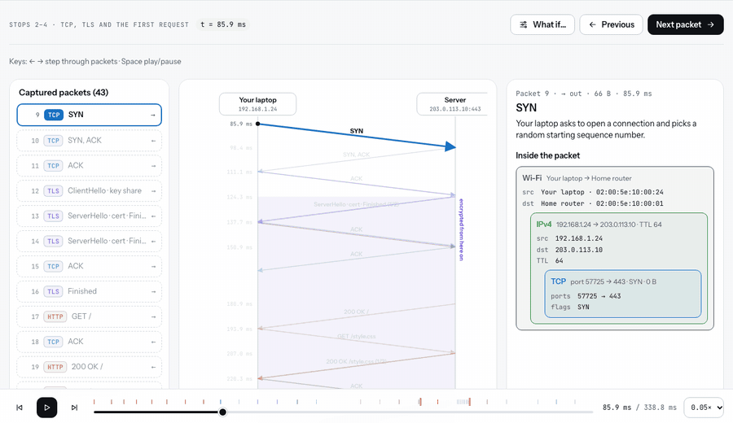
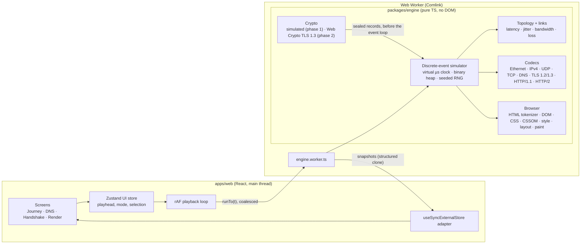

# Packet Trip

Everything that happens between pressing Enter on `https://example.com` and the page appearing — packet by packet, byte by byte.

A deterministic simulation engine builds every packet as real bytes (Ethernet II → IPv4 → UDP/TCP → DNS / TLS → HTTP), decodes them back for the inspector, and runs a small browser that parses, styles, lays out and paints the page. You can pause anywhere, open any packet, and read it. **The site never sends real network traffic.**



## Quick start

```sh
pnpm install
pnpm dev            # http://localhost:5173
pnpm verify         # typecheck → lint → unit/property/component tests → build
pnpm e2e            # Playwright (builds are served with `vite preview`)
```

Requires Node ≥ 20 and pnpm 9. Any moment is shareable: `/handshake?seed=42&packet=5`, `/render?seed=42&t=262` (t in ms). What-if settings are in the URL too (`tls=1.2`, `http=2`, `cdn=0`, `rtt=2`, `loss=5`, `dns=browser`, `ns1timeout=1`, `inline=1`).

## Architecture



- **`packages/engine`** has no dependencies and never touches `Date.now`, `Math.random`, `fetch` or the DOM (ESLint enforces this). It runs unchanged in Node, a worker or a page. `src/index.ts` is the only public surface: `createSimulation(config)` returns `runTo`, `stepForward`, `stepBack`, `getSnapshot`, `getPacket`, `subscribe`. Everything it returns is a plain, structured-clone-safe object.
- **`apps/web`** runs the engine in a Web Worker through Comlink. Seeks are coalesced (latest wins), so dragging the timeline never queues stale work. React reads worker state through `useSyncExternalStore`. The network map animates packet dots with `requestAnimationFrame` and refs, without re-rendering React each frame.
- Text measurement for layout is done in the web app (canvas `measureText` per character, per font) and handed to the engine as a table, so the engine stays DOM-free and the fake browser draws exactly what the engine laid out.

### Engine layout

| Folder     | What lives there                                                                                                                                                         |
| ---------- | ------------------------------------------------------------------------------------------------------------------------------------------------------------------------ |
| `sim/`     | virtual clock, event queue (ties break by insertion order), mulberry32 RNG with labelled sub-streams, the world, DNS and web actors, the public `Simulation`, self-tests |
| `net/`     | documentation-range topology, FIFO links (serialization at link rate, propagation + jitter, loss on the ISP link), the TCP state machine                                 |
| `proto/`   | encoders/decoders that also emit annotated fields with byte ranges                                                                                                       |
| `content/` | the four built-in sites and the session plan (every TLS record each side will write)                                                                                     |
| `browser/` | incremental tokenizer, tree builder, CSS parser, CSSOM with specificity, style, block + inline layout, display list                                                      |
| `crypto/`  | record sealing; simulated ciphertext; the real TLS 1.3 key schedule                                                                                                      |

## What is real and what is simulated

**Real, byte for byte**

- Ethernet II, IPv4 (with a computed and verified header checksum, DF, TTL 64 decremented per router hop), UDP and TCP (pseudo-header checksums, SYN options MSS 1460 / window scale / SACK-permitted).
- TCP behaviour: 3-way handshake, MSS segmentation, delayed ACKs (every second segment or 40 ms), an initial window of 10 segments with slow start and congestion avoidance, RFC 6298 retransmission timeouts, fast retransmit and NewReno-style recovery, graceful FIN.
- DNS per RFC 1035: IDs, flags, length-prefixed names, name compression (including inside NS records), referrals with glue, TTLs honored by the browser, OS and resolver caches, and the ns1 → ns2 retry after 400 ms.
- TLS record and handshake structure: ClientHello (SNI, supported_versions, supported_groups, key_share, signature_algorithms, ALPN), ServerHello, EncryptedExtensions, a structurally valid X.509 chain, CertificateVerify, Finished; TLS 1.2's 2-RTT flow for comparison. TLS records split across TCP segments are decoded like Wireshark's reassembly would.
- HTTP/1.1 requests and responses (`x-cache`, `age`, `cache-control`…), keep-alive and sequential fetches.
- **Phase 2 crypto (TLS 1.3):** X25519 key agreement, HKDF-Extract / HKDF-Expand-Label, transcript hashes, real Finished MACs and AES-128-GCM with per-record nonces, all through Web Crypto. "Decrypt" then really decrypts the record bytes in the worker, and the key-schedule panel shows every derived secret. The primitives are tested against the RFC 8448 values.

**Simulated or simplified**

- The certificates are fake (random key and signature bytes in a valid DER structure), and so is the CertificateVerify signature.
- TLS 1.2 records use simulated ciphertext (pseudo-random bytes of the exact length). Phase 1 mode does the same for TLS 1.3 when X25519 isn't available in Web Crypto; the UI says so.
- The CDN ↔ origin connection is pre-warmed and its records are simulated.
- HTTP/2 uses real frame headers, stream IDs and flags, but header blocks are plain text instead of HPACK (labelled "simplified").
- Wi-Fi is shown as an Ethernet II header, and ARP is assumed cached. Loss applies only to TCP segments on the ISP access link.
- The browser covers the subset the built-in pages use (doctype, html/head/title/link/style/script/body/div/h1/p/a; type/class/id selectors and about 15 properties), with sibling margin collapsing and greedy line breaking.

## How determinism works

- One seed drives everything. `createRng(seed).fork(label)` derives independent sub-streams (ports, ISNs, DNS IDs, jitter, loss, TLS randoms, key shares), so changing the loss rate doesn't change your ports.
- The event queue is a binary heap ordered by (time, insertion order), so equal-time events always run in the same order.
- Everything that travels inside TLS is planned and sealed **before** the event loop starts. Real Web Crypto is async, so it runs as a precompute step; the records it produces have exactly the same lengths as simulated ones, so timings are identical in both crypto modes (a test checks this).
- **Step back** re-simulates from t = 0 to the previous event boundary instead of keeping an undo stack. A full run takes a few milliseconds.
- At most 2,000 packets keep their bytes in memory; older ones keep only their summary.

## Tests

| Layer  | Tool                     | What it checks                                                                                                                                                                                                                                                                                          |
| ------ | ------------------------ | ------------------------------------------------------------------------------------------------------------------------------------------------------------------------------------------------------------------------------------------------------------------------------------------------------- |
| Engine | Vitest                   | golden bytes for each protocol with hand-checked checksums (RFC 1071 example, the classic `0xb861` IPv4 header, hand-computed UDP and TCP sums), DNS compression and loop rejection, DER certificates, HTTP parsers; full-run snapshots per built-in site; 14 scenarios that must pass every self-check |
| Engine | fast-check               | encode(decode(bytes)) = bytes for random frames; checksums always verify; DNS names with random labels round-trip; seq/ack stay consistent and bytes balance under random loss; same seed + config ⇒ identical event log                                                                                |
| Engine | Vitest + Node Web Crypto | RFC 8448 key-schedule values, real decryption of every record, deterministic keys, TLS 1.2 fallback                                                                                                                                                                                                     |
| Web    | React Testing Library    | hex dump ↔ field list hover sync, Story/Expert field filtering, packet-list keyboard navigation, every engine message and UI key translated in EN and TR with matching placeholders                                                                                                                     |
| E2E    | Playwright               | press Enter → DNS completes; open packet 5 → Decrypt → read the plaintext; a longer RTT makes the total grow; arrow-key stepping; unknown-site picker; the in-browser self-test passes; no horizontal page scroll; visual snapshots of all four screens in light/dark × desktop/phone                   |

The Expert-mode **Run checks** panel runs the same five self-checks in your browser.

Visual baselines are per platform. The committed ones were generated on macOS; to add Linux baselines for CI, run the CI workflow manually with **update_snapshots** checked, download the `linux-baselines` artifact into `e2e/visual.spec.ts-snapshots/`, and commit. Until those exist, CI skips the visual comparison and still runs every functional end-to-end test.

## CI and deploy

`.github/workflows/ci.yml` runs typecheck → lint (ESLint + Prettier) → tests → build → Playwright (in the official Playwright container). `.github/workflows/deploy.yml` deploys `apps/web/dist` to Vercel: production on `main`, a preview per pull request with the URL posted as a comment. It needs the `VERCEL_TOKEN`, `VERCEL_ORG_ID` and `VERCEL_PROJECT_ID` repository secrets. `apps/web/public/_redirects` also makes the build work as-is on Cloudflare Pages.

## Addresses

All addresses come from documentation ranges: 192.0.2.0/24, 198.51.100.0/24 and 203.0.113.0/24 (RFC 5737), plus 192.168.1.0/24 for the home network and locally administered MACs (`02:00:5e:…`).
